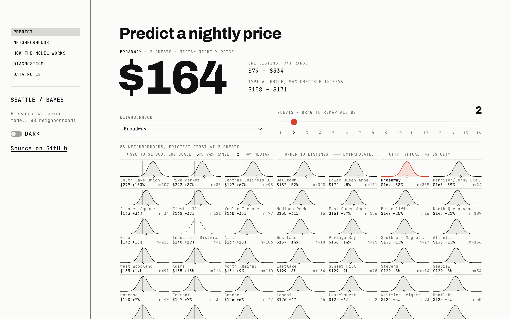
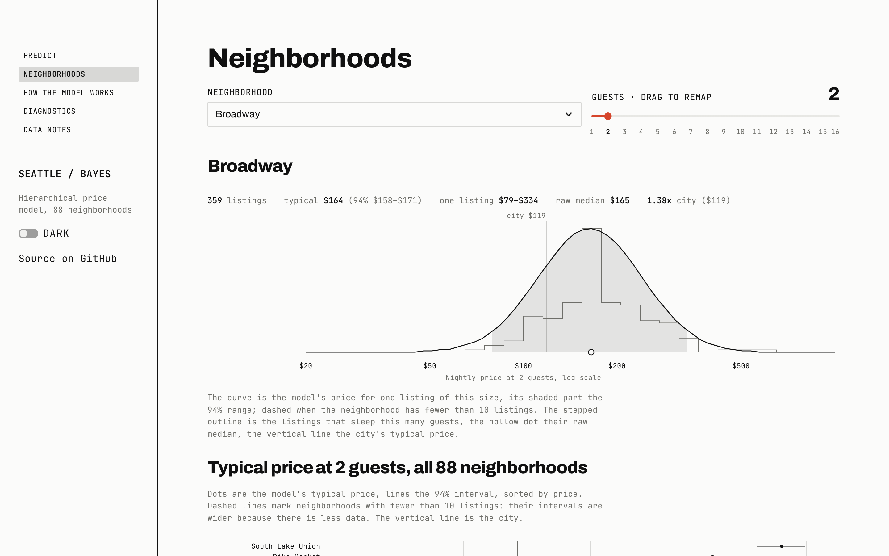
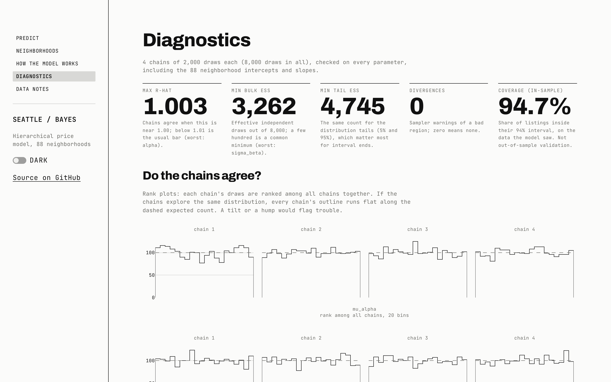

# Bayesian Airbnb Price Model, Seattle

[](https://github.com/Dennis-J-Carroll/bayesian-analysis-of-airbnb-seattle-market/actions/workflows/ci.yml)
[](LICENSE)
[](https://www.python.org/downloads/)

**Live app: https://bayesian-analysis-dashboard.streamlit.app/**

A hierarchical Bayesian regression of Seattle Airbnb nightly prices, with an interactive Streamlit app on top. Every price estimate is a posterior distribution with a credible interval, not a single number. Neighborhoods share information through a hierarchy (partial pooling), so a neighborhood with few listings is pulled toward the city average instead of being estimated from almost nothing.

The app shows only what the deployed model does. Every number below is read from files in `outputs/app_artifacts/`, which `scripts/build_artifacts.py` regenerates from the posterior trace.



| | |
|---|---|
|  |  |

## The model

PyMC model on `log(price)` with a varying intercept and a varying slope on guest count, one pair per neighborhood:

```
log(price_i) ~ Normal(alpha[n_i] + beta[n_i] * accommodates_i, sigma)
alpha[n] ~ Normal(mu_alpha, sigma_alpha)
beta[n]  ~ Normal(mu_beta,  sigma_beta)

mu_alpha ~ Normal(4.5, 1)      sigma_alpha ~ HalfNormal(0.5)
mu_beta  ~ Normal(0.2, 0.1)    sigma_beta  ~ HalfNormal(0.1)
sigma    ~ HalfNormal(0.5)
```

- 6,144 listings in 88 neighborhoods after cleaning.
- `accommodates` enters unstandardized (raw guest count).
- Sampled with NUTS: 4 chains x 2,000 draws.
- "Typical price" is `exp(alpha + beta * guests)`. The "one listing" range also includes the noise term `sigma`, so it is wider. Both are equal-tailed 94% intervals (3rd to 97th percentile).

## Verified numbers

| Quantity | Value |
|---|---|
| Listings used / raw rows | 6,144 / 6,862 |
| Neighborhoods | 88 |
| Chains x draws | 4 x 2,000 |
| Max R-hat (all parameters) | 1.003 |
| Min bulk ESS | 3,262 |
| Min tail ESS | 4,745 |
| Divergences | 0 |
| In-sample 94% interval coverage | 94.7% |
| Price change per extra guest (median, 94% interval) | +17.5% (16.7% to 18.3%) |

Coverage is measured on the same data the model was fit to. It is a calibration check, not out-of-sample validation, and the app says so. Run `python scripts/build_artifacts.py` to regenerate the values from the trace; tests compare the committed files against it.

## Data

Source: [Inside Airbnb](http://insideairbnb.com/get-the-data/), Seattle listings scraped 2025-06-21 to 2025-06-30, licensed CC BY 4.0. Cleaning rules, with counts on `data/raw/listings.csv`:

1. 6,862 raw rows.
2. Drop 635 rows with no price (none were missing guest count or neighborhood): 6,227 remain.
3. Drop 83 rows priced over $1,000. Of these, 29 are hotel-room listings and 37 are priced at $10,000 or more ($40,000 to $50,034 a night), which look like placeholders. No rows were under $10.
4. 6,144 listings kept (price between $10 and $1,000).

The app's Data notes page states the same decisions.

## Run locally

Python 3.11.

```bash
python3.11 -m venv venv
source venv/bin/activate
pip install -r requirements.txt          # enough to run the app
streamlit run app.py
```

The app reads the committed artifacts, so it does not need PyMC or the trace. `./run_dashboard.sh` does the same thing.

Requirements files: `requirements.txt` (run the app), `requirements-model.txt` (PyMC and ArviZ, for model and artifact work), `requirements-dev.txt` (tests, includes the other two).

## Tests

```bash
pip install -r requirements-dev.txt
python -m pytest -q                      # fast suite (default)
python -m pytest -m slow                 # fits a small PyMC model (minutes)
python -m pytest -m trace                # needs the real trace: git lfs pull
python -m pytest -m e2e                  # browser tests
```

For e2e, install the browser once with `python -m playwright install chromium`. The `trace` tests check that the committed artifacts are faithful to `outputs/model_trace.nc`. CI runs the fast, model and e2e jobs on every push and pull request.

## Rebuild artifacts

The trace is stored with Git LFS (about 377 MB), so it is not in a plain clone.

```bash
git lfs pull
pip install -r requirements-model.txt
python scripts/build_artifacts.py
```

This rewrites `outputs/app_artifacts/` (JSON summaries and a 1,000-draw subsample, `draws.npz`, with a fixed seed).

## Deploy

The live app runs on Streamlit Community Cloud: repository `Dennis-J-Carroll/bayesian-analysis-of-airbnb-seattle-market`, branch `master`, main file `expert_dashboard.py` (a thin entry that calls `app.main`), tested on Python 3.11. Cloud installs `requirements.txt` only; it never fits the model.

## Project layout

```
app.py                  app shell and navigation
expert_dashboard.py     Streamlit Cloud entry point
dashboard/              pages, components, posterior and artifact utilities
scripts/build_artifacts.py   trace -> committed artifacts
outputs/app_artifacts/  numbers the app and this README use
src/                    legacy modeling and EDA scripts; the deployed model is fitted by src/hierarchical_bayesian_model.py
notebooks/              exploratory analysis (not the source of the numbers above)
tests/                  fast, slow, trace and e2e tests
```

## Limitations

The model uses guest count and neighborhood only. It does not see property type, amenities, reviews or season, and it does not claim to explain price beyond that. No out-of-sample accuracy figure is reported because none has been computed.

## License

MIT, see [LICENSE](LICENSE). Data: Inside Airbnb, CC BY 4.0.
